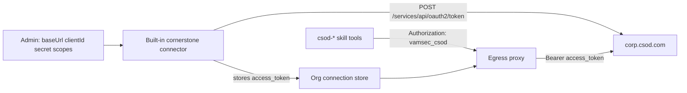

# Plan: Built-in Cornerstone OnDemand connector (VAM)

Status: built-in descriptor in **`squrell-inc/VAM`** (`spec/connectors/cornerstone.json`); marketplace listing is skills-only (M365 pattern).

Skills under `listings/cornerstone/` expect:

`urn:vam:connector:hub.squrell.cloud/squrell/cornerstone`

Admin Enable form fields come from VAM schema: `client: "org"` + `clientSecret: "org_vault"` (Client ID + Client secret). Not a custom `config.fields` list.

See also: [cornerstone-connector-contract.md](cornerstone-connector-contract.md), [cornerstone-api-catalog.md](cornerstone-api-catalog.md).

---

## Goal

Admin configures Cornerstone API credentials once. Every member can use the Cornerstone skills. Skills never see secrets.

This is **OAuth**, but **not** Microsoft 365 user login:

| | Microsoft 365 | Cornerstone |
|---|---|---|
| Grant | Authorization code (member browser) | **Client credentials** (app) |
| Admin stores | Built-in Entra app (usually) | Base URL, client id, secret, scopes |
| Members | Connect with Microsoft account | No secrets; just use agent |

---

## Architecture



---

## Admin credential fields (enough)

| Field | UI label | Example | Notes |
|---|---|---|---|
| `baseUrl` | Portal base URL | `https://acme.csod.com` | Normalize to host `acme.csod.com` |
| `clientId` | Client ID | from Edge → API Management | Required |
| `clientSecret` | Client secret | shown once in CSOD | Required; encrypt at rest |
| `scopes` | Scopes | `training:read transcript:read employee:read ...` | Space-separated; max 20 per CSOD token call |

**Hardcoded (do not ask admin):**

- `grantType` = `client_credentials`
- Token path = `/services/api/oauth2/token`
- Placeholder for skills = `vamsec_csod`
- Binding id = `csod`

**Not required:** redirect URI, member username/password, refresh-token UI.

---

## Token flow

1. Admin saves credentials → connector marked enabled / configured.
2. On first need (or schedule), node:

```http
POST {baseUrl}/services/api/oauth2/token
Content-Type: application/json

{
  "clientId": "...",
  "clientSecret": "...",
  "grantType": "client_credentials",
  "scope": "training:read transcript:read ..."
}
```

3. Store `access_token` + `expires_in`; refresh before expiry (e.g. 60s skew).
4. When a skill calls egress with `Authorization: vamsec_csod` and `X-Target-Url: https://{host}/...`:
   - Verify host matches configured portal host
   - Replace placeholder with `Bearer {access_token}`
   - Forward request

---

## Connector definition (platform shape)

Mirror built-in Microsoft 365 connector patterns in VAM:

- **id:** `cornerstone`
- **URN:** `urn:vam:connector:hub.squrell.cloud/squrell/cornerstone`
- **displayName:** `Cornerstone OnDemand`
- **connection.holder:** org (shared) — not per-member user OAuth
- **provider:** client-credentials style (VAM-internal; not marketplace `discover`)
- **bindings:** one binding `csod` → host from `baseUrl`, credential placeholder `vamsec_csod`
- **egress allowlist:** only `{corp}.csod.com` over HTTPS

Reserve id `cornerstone` so marketplace connectors cannot reuse it.

---

## Org / member UX

1. Admin: Org settings → Connectors → Cornerstone → Enable  
2. Admin: enter base URL, client id, secret, scopes → Save / Test connection  
3. Admin: install marketplace listing `cornerstone` at ref tag  
4. Members: open **Cornerstone assistant** — no CSOD secrets  

**Test connection:** call token endpoint; show success or CSOD error description.

---

## Prerequisites in Cornerstone (customer)

Before VAM setup, CSOD admin must:

1. Edge → API Management → Register application  
2. Bind a **service account** user with needed security permissions  
3. Select scopes on the app that match what they will paste into VAM  

---

## Implementation work (in VAM repo)

1. ~~Built-in descriptor~~ — `spec/connectors/cornerstone.json` (`client: org`, `org_vault`, REST `csod` binding)  
2. CSOD **client_credentials** token exchange (API is not discover/auth-code)  
3. Corp host / company address (Phase 6) so binding is `{corp}.csod.com`, not only `example.csod.com`  
4. Egress: `vamsec_csod` → Bearer + host enforce  
5. Tests: mock token + mock API egress (like M365)  

**Out of scope for this connector plan:** Bulk/Reporting/Webhooks.

---

## Acceptance checklist

- [ ] Admin can save base URL, client id, secret, scopes  
- [ ] Test connection obtains a token from CSOD  
- [ ] Skill call with `vamsec_csod` reaches `{corp}.csod.com` with real Bearer token  
- [ ] Wrong host in `X-Target-Url` is blocked  
- [ ] Members never see client secret  
- [ ] Listing `cornerstone` skills run after connector enable + listing install  

---

## Dependency

| Piece | Repo | Status |
|---|---|---|
| Skills / agent / playbook | `vam-marketplace` | Done (`listings/cornerstone`) |
| Built-in connector file (Enable: client id + secret) | `VAM` | Done (`spec/connectors/cornerstone.json`) |
| CSOD client_credentials token + corp host | `VAM` | **Still to build** |
