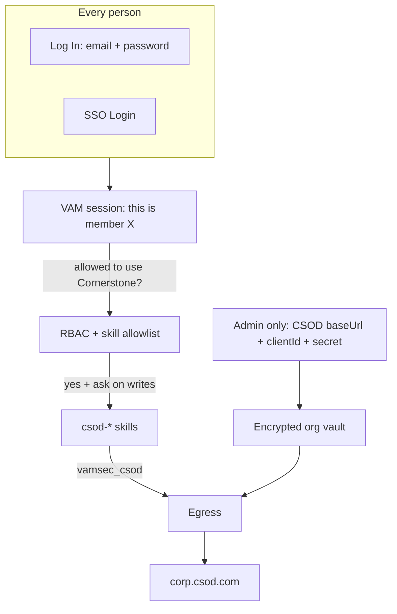

# Plan: Who authenticates for Cornerstone (misuse control)

## Problem

Sharing one Cornerstone **admin / app** credential with everyone is unsafe: any person who can run the agent acts as the same CSOD service account and can misuse it.

You want: **every person authenticates themselves**, with two login paths like Vithi:

1. **Log In** — email/username + password  
2. **SSO Login** — company identity provider  

## Important split (two different logins)

| Layer | What it is | Who authenticates | How |
|---|---|---|---|
| **A. VAM / Vithi** | Using Squrell / agents / skills | **Every member** | Log In **or** SSO Login (your screenshot) |
| **B. Cornerstone API** | Calling `*.csod.com` REST APIs | **Org only** (one registered app) | Client id + secret (`client_credentials`) |

Cornerstone’s public API docs: **only** Client Credentials for API tokens. There is **no** “each employee connects with CSOD password / CSOD SSO” grant for third-party tools like VAM.

So we **cannot** build a true M365-style “Connect your Cornerstone account” for every member. We **can** still make misuse hard by forcing every person through Vithi auth + tight VAM controls, while CSOD secrets stay with the admin vault only.

## What we will NOT do

- Do **not** give members the CSOD client id/secret  
- Do **not** ask each member for their Cornerstone portal password (worse security; not the API auth model)  
- Do **not** pretend CSOD supports per-user OAuth login for this connector  

## Target UX

### 1) Everyone authenticates to Vithi / VAM first

Same as your login screen:

- **Log In** → email/username + password  
- **SSO Login** → IdP (Entra / Okta / etc.)  

No authenticated VAM session → no agent, no Cornerstone skills.

### 2) Admin alone configures Cornerstone (once)

Org settings → Connectors → Cornerstone:

- Portal base URL  
- Client ID  
- Client secret  
- Scopes  

**Test connection** → store encrypted. Members never see these fields.

### 3) Who may use Cornerstone (stops misuse)

Even after VAM login, **not everyone** automatically gets CSOD power:

| Control | Behavior |
|---|---|
| Listing enable | Admin enables `cornerstone` listing for the org |
| Role / group gate | Only groups you choose may use Cornerstone assistant / csod skills (e.g. HR, L&D) |
| Write tools | Already `ask` — member must approve assign/create/update |
| Read tools | Optional: also restrict by role |
| Audit | Every tool run logs **VAM member id** + tool + time (even though CSOD token is the org app token) |

That way a random employee who can log into Vithi still cannot blast CSOD APIs unless an admin put them in the allowed group.

### 4) Optional tighter CSOD-side limits

In Cornerstone Edge when registering the app:

- Bind a **least-privilege service account** (not a full admin user)  
- Select **only** scopes the skills need  
- Prefer separate apps later if you split Learning vs Recruiting  

## How the two login buttons map

| Button on Vithi | Means for Cornerstone connector |
|---|---|
| **Log In** | Member proves identity to VAM with password → may use allowed skills |
| **SSO Login** | Member proves identity to VAM via SSO → same; still no CSOD secret |

Both paths only authenticate **the person in VAM**. They do **not** replace the admin CSOD app credentials.

## Implementation work

### In VAM (platform)

1. Keep Cornerstone connector as **org** `client_credentials` (descriptor already drafted).  
2. Ensure connector secrets are admin-only UI; never in skill env.  
3. Add / use **RBAC** so Cornerstone listing or `csod-*` skills require a role/group.  
4. Audit trail: actor = VAM user on every egress/tool call.  
5. Keep write tools on member approval (`ask`).  

### In marketplace (this repo)

1. Connector + skills stay as they are (org URN, `vamsec_csod`).  
2. Document in contract: members auth via VAM Log In / SSO; CSOD creds admin-only.  
3. Agent copy: “Uses the org Cornerstone connection; you must be signed in to VAM.”  

### Out of scope until Cornerstone ships it

Per-member CSOD OAuth / “Sign in with Cornerstone” for API calls (not supported today except LMS widget iframe flow, which is not VAM).

## Acceptance checklist

- [ ] Member without VAM session cannot run any csod skill  
- [ ] Member can reach VAM via **Log In** or **SSO Login**  
- [ ] Member never sees CSOD client secret  
- [ ] Member outside allowed group cannot use Cornerstone assistant / skills  
- [ ] Write tools always prompt that member for approval  
- [ ] Audit shows which VAM user triggered which CSOD call  
- [ ] Admin Test connection still uses org client credentials only  

## Decision

| Goal | Approach |
|---|---|
| Everyone must authenticate | **Yes** — via Vithi **Log In** or **SSO Login** |
| Everyone enters CSOD credentials | **No** — CSOD API does not support that; unsafe and unsupported |
| Stop misuse of shared CSOD power | **Yes** — org vault + RBAC + ask-on-write + audit + least-privilege CSOD app |

See also: [cornerstone-connector-plan.md](cornerstone-connector-plan.md), [cornerstone-connector-contract.md](cornerstone-connector-contract.md).
